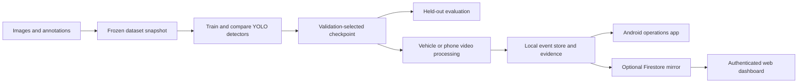

# RoadGuard AI

RoadGuard AI is a research prototype for detecting road damage from images and video and reviewing the resulting maintenance events. It combines a reproducible YOLO training workflow, a video processing pipeline, and a Flutter operations app for Android and the web.

## What it does

- **Detection:** Locates longitudinal cracks (`D00`), transverse cracks (`D10`), alligator cracks (`D20`), and potholes (`D40`).
- **Video processing:** Groups repeated detections across frames and writes event records and evidence to a local archive. Vehicle runs can also write SQLite records.
- **Android inspection:** Selects or records a video, submits it for processing to a paired computer, and shows the resulting events. Camera clips can associate events with time-matched phone location samples when permission and accuracy allow.
- **Web operations:** Uses Firebase email/password sign-in and an `admin` claim to open the Firestore dashboard. Administrators can review events and update their maintenance status and priority. The paired phone reads the local service. Web changes stay in Firestore until a two-way sync is implemented.
- **Notifications:** The paired computer can send Firebase Cloud Messaging alerts to registered Android installations when an event's priority is elevated through the local service.



## Quick start

Use Python 3.11 or 3.12. From the repository root:

```shell
python -m pip install -e ".[acquisition,eda,notebooks,dev,lan]"
python -m pytest
python -m jupyterlab
```

For the Flutter demonstration, install Flutter 3.47.1 or a compatible version and run:

```shell
cd apps/roadguard_mobile
flutter pub get
flutter run -d chrome --dart-define=ROADGUARD_FIREBASE=false
```

The demo runs with synthetic event records and illustrative graphics. The operations interface is Arabic and right-to-left. Public setup instructions and research notes are in English.

## Research results

The validation-selected **YOLO26s** detector achieved **63.64% mAP50** and **31.70% mAP50–95** across **3,019 held-out images**, with **68.66% precision** and **57.67% recall**. These results characterize a research evaluation. Maintenance priority is an operator-controlled workflow field, and physical severity remains unassessed.

| Guide | Contents |
| --- | --- |
| [Training and evaluation](docs/training-and-evaluation.md) | Dataset preparation, notebooks, experiment reproduction, and held-out results |
| [Operations and Firebase](docs/operations-and-firebase.md) | Android LAN workflow, web admin, deployment, and access control |
| [Flutter app](apps/roadguard_mobile/README.md) | Local demo and app checks |
| [Event database schema](docs/roadguard_event_database_schema.md) | SQLite sessions, events, and identifiers |

The repository includes source, configuration profiles, tests, and review notebooks. Datasets, checkpoints, inspection recordings, live databases, credentials, and generated experiment files are kept outside Git. Training runs write review artifacts to `artifacts/experiments/<run>/` so the same notebook can reopen their results.

## License

Project code is distributed under the [GNU Affero General Public License v3.0](LICENSE). Check the terms of the dataset, model weights, and dependencies before redistribution.
